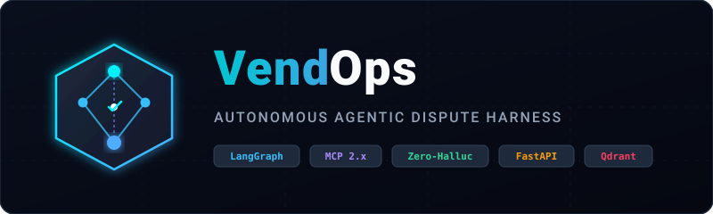

<div align="center">



<br/><br/>

[](https://nextjs.org/)
[](https://react.dev/)
[](https://www.typescriptlang.org/)
[](https://tailwindcss.com/)
[](https://reactflow.dev/)
[](https://tanstack.com/query)
[](LICENSE)

<br/>

**Mission Control Portal for Autonomous Accounts Payable Dispute Resolution & Human-in-the-Loop Governance**  
*Built with Next.js 15 App Router, Industrial Dark Glassmorphism, React Flow live graph orchestration, and real-time Server-Sent Events (SSE).*

</div>

---

## 🎨 Design System: "Industrial Dark"

The VendOps Web UI implements the **Industrial Dark** aesthetic specification engineered for high-density enterprise operations:
- **Base Background**: `#09090B` (Deep Carbon Zinc)
- **Panel Surfaces**: `rgba(24, 24, 27, 0.9)` with `backdrop-filter: blur(12px)` glassmorphism
- **Border Matrix**: `rgba(63, 63, 70, 0.4)`
- **Typography**: `Plus Jakarta Sans` for labels & navigation; `JetBrains Mono` for telemetry, amounts, and canonical IDs
- **Semantic Accents**: Primary Blue (`#3b82f6`), Success Emerald (`#10b981`), Warning Orange (`#f97316`), Critical Red (`#ef4444`)
- **Theme Switcher**: Instant toggle between Industrial Dark and Light Mode via header controls

---

## 🖥️ Screen Architecture

The application contains 8 purpose-built operational interfaces:

### 1. `/` (Mission Control Overview)
- **4-Column KPI Grid**: Total Disputes Processed (420+), Auto-Resolution Rate (98.2% STP), Pending HITL Queue, and Labor Saved (97.2% vs 26.0 min APQC baseline).
- **Service Connectivity Panel**: Live health monitor for FastAPI (`:8000`), Qdrant Vector Store (`:6333`), MCP Tool Server, and Zero-Hallucination Guard.
- **Recent Disputes Log**: Real-time table filterable by status with inline dialect badges (Hinglish/English).

### 2. `/disputes/new` (Submission Console)
- **Multi-Dialect Textarea**: Real-time dialect classifier detecting **Hinglish (Roman)**, **Hindi (Devanagari)**, or **English (Formal)** with character counter (`0 / 10,000`).
- **One-Click Test Scenarios**: Quick-fill presets for Hinglish short delivery, English payment delay, $120,000 HITL high-value gate, and price variance claims.
- **EasyOCR File Upload**: Extracts raw text, canonical IDs (`INV-...`, `PO-...`, `GRN-...`, `VND-...`), and detected currency amounts from invoice scans or PDFs.

### 3. `/disputes/[id]` (Live Execution Run View)
- **Interactive React Flow Graph**: 8 sequential LangGraph nodes (`ingest` ➔ `compress` ➔ `triage` ➔ `verify` ➔ `decide` ➔ `hitl_gate` ➔ `execute` ➔ `respond`). Active node pulses blue; completed nodes glow emerald; paused HITL node pulses orange.
- **Streaming Telemetry Panels**:
  - *Extracted Entities*: Canonical IDs (`INV-...`, `PO-...`, `GRN-...`, `VND-...`) highlighted inline in original vendor query.
  - *Triage Card*: DisputeType category, Priority, and confidence percentage.
  - *Context Compression*: Subword token fertility ratio and -45.9% token savings tracker.
  - *3-Way Match Audit Table*: Side-by-side reconciliation of PO authorized amount, GRN dock intake, and Invoice billed claim.
  - *SOP Citations*: Semantic policy cards retrieved from Qdrant vector database.
  - *Resolution Proposal*: Recommended action enum, amount, rationale, and evidence trail.
  - *Grounded Vendor Reply*: Synthesized response rendered in vendor's input dialect.

### 4. `/approvals` (Human-in-the-Loop Queue)
- **HITL Review Cards**: Summarizes financial exposure, reason for suspension ($\ge \$100,000$ or low confidence), and 3-way match snapshot.
- **Review Modal**: Supports **Approve**, **Reject**, or **Modify Terms** (override action enum + override amount).
- **Non-Optimistic Execution**: Enforces required Reviewer ID and comments; reflects true backend-confirmed state only.

### 5. `/audit` (Compliance Ledger)
- **Immutable Table**: Searchable audit entries (`AUD-...`, timestamps in `Asia/Kolkata`, invoice, PO, vendor, amount, idempotency keys).
- **Client-Side CSV Export**: Generates RFC-4180 compliant CSV downloads (`vendops_audit_ledger_<timestamp>.csv`).

### 6. `/erp` (Enterprise Records Explorer)
- **Read-Only Entity Browser**: 4 tabs exploring simulated enterprise SQLite tables (`Invoices`, `Purchase Orders`, `Goods Receipts`, `Vendors`).
- **Dispute Cross-Linking**: Direct links from ERP documents back to related active dispute threads.

### 7. `/quality` (Automated Evals Dashboard)
- **Empirical Gate Status**: Prominently displays **"0 HALLUCINATIONS / RELEASE QUALIFIED"**.
- **Mandatory Source Attribution**: Every metric card and chart is labeled with its dataset (`disputes_400.jsonl`), case count (`420 cases`), and runner (`FakeLLM / synthetic` vs `Live LLM`).
- **Tail-Segmented Slice Tables**: Evaluates worst-slice performance across Script (`devanagari` 100% TCR), Code-Mix Index, Thread Depth, and Noise Level (`high_noise` 4.82% WER).

### 8. `/guard` (Tool-Call Guard Inspector)
- **3 Defense Layers Overview**: Layer 1 (Schema with `extra="forbid"`), Layer 2 (Zero-Hallucination Provenance Registry), Layer 3 (2-repair circuit breaker).
- **Interception Timeline**: Log of blocked tool calls with rejection diagnostics.
- **Interactive Provenance Sandbox**: Live simulator testing extracted IDs against mock tool dispatches.

---

## ⚡ Quickstart

### 1. One-Click Launch (Windows 11 / PowerShell)
Both the backend Docker stack and frontend Next.js server can be launched together:

```cmd
:: Launch everything (Backend Docker + Frontend Web UI)
start.bat

:: Shutdown everything cleanly
stop.bat
```

```powershell
# Native PowerShell Launcher
.\start.ps1

# Shutdown
.\stop.ps1
```

### 2. Terminal User Interface (TUI)
For operational debugging or testing without a browser, run:

```cmd
:: Launch Terminal TUI
tui
```
```powershell
# or via Python / Bun
python bin\vendops-tui.py
bun run tui
```

Features:
- Live sample dispute runner (Hinglish short delivery, English payment delay, $120k HITL approval)
- Interactive prompt for custom queries
- Terminal-based HITL approval queue with Approve / Reject keyboard prompts
- Evaluation & benchmark matrix viewer
- Multilingual EasyOCR entity extraction test

### 3. Manual Development & Offline Mode
```bash
# Install dependencies
bun install   # or npm install

# Start Next.js development server on port 3000
bun run dev

# Offline Mock Mode (Runs 100% without backend via MSW)
NEXT_PUBLIC_USE_MOCKS=1 bun run dev
```

---

## 🔗 Architecture & Backend Coordination

```
Browser Client (Port 3000)
       │
       ▼
Next.js Rewrite Proxy (/api/backend/*)
       │
       ▼
FastAPI + LangGraph Service (Port 8000)
       ├──> Qdrant Vector Store (Port 6333) [FastEmbed Multilingual]
       ├──> SQLite Mock ERP (MCP 2.x Tools) [Idempotent Mutations]
       └──> EasyOCR Engine (ocr/easyocr)    [Scanned Invoice Extraction]
```

---

## 🚫 What The UI Does Not Claim

1. **Non-Optimistic Approvals**: Action buttons on `/approvals` show an active loading spinner and update only after the backend confirms `POST /resume`. Approval is never faked in the UI.
2. **Attributed Evals**: Benchmark metrics in `/quality` and `/` are clearly tagged as generated from the 420-case synthetic dataset (`disputes_400.jsonl`) run against `FakeLLM` for deterministic offline reproduction.
3. **No Direct Wire Transfers**: Approved actions record immutable audit ledger rows and update ERP ledgers; bank wire transfers require downstream banking gateway integration.

---

## 📄 License

Licensed under the [MIT License](LICENSE).  
Vendored subcomponents retain their respective original licenses.
